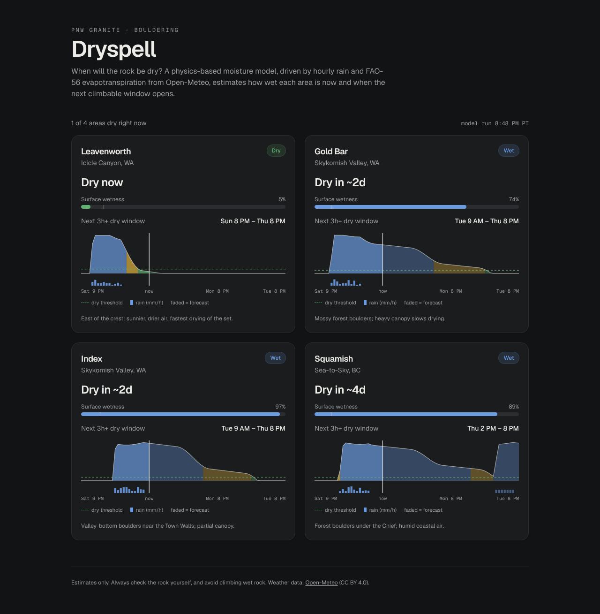
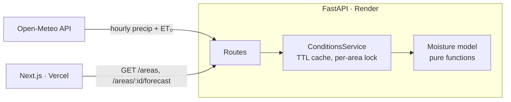

# Dryspell

**When will the rock be dry?** Dryspell estimates how wet Pacific Northwest granite bouldering areas are right now and predicts when the next climbable window opens, using a physics-based moisture model driven by hourly rain and FAO-56 evapotranspiration.

**Live demo:** [dryspell.vercel.app](https://dryspell.vercel.app) · **API docs:** [dryspell-api.onrender.com/docs](https://dryspell-api.onrender.com/docs)



## Why

PNW off-season climbing is a game of short, unpredictable dry windows. Weather apps tell you whether it will rain. They don't tell you whether the rock has dried from yesterday's rain. Dryspell answers that question for four granite areas: Gold Bar, Index, Leavenworth, and Squamish.

The scope is deliberately limited to granite. Granite is effectively impermeable, so surface moisture follows a simple water balance and the model stays accurate. Granite also isn't weakened by moisture the way sandstone is, so a wrong "dry" call costs a wasted drive, not a damaged hold.

## The model

Each area is a single "bucket" of surface water, stepped hourly:

```
W ← min(W + P, capacity)                         rain fills; excess runs off
W ← max(0, W − max(k · ET₀, floor))              evaporation drains
```

| Symbol | Meaning |
|---|---|
| `P` | hourly precipitation (mm), from Open-Meteo |
| `ET₀` | FAO-56 reference evapotranspiration (mm/h), from Open-Meteo. It already combines temperature, humidity, wind, and solar radiation. |
| `k` | per-area drying factor for exposure: below 1 for shaded forest, above 1 for sunny, dry-air sites |
| `capacity` | water the surface and shallow cracks can hold before it runs off |
| `floor` | small baseline drying from drainage and wind, so the bucket still empties when `ET₀ ≈ 0` |

The rock is **dry** when `W` is at or below a threshold, **damp** below a second threshold, and **wet** above that. The API spins the bucket up on 7 days of past weather, so the current state reflects recent rain, then runs it forward over a 4-day forecast to find:

- `hours_until_dry`
- the next dry window of at least 3 hours

Implementation: [`backend/app/model.py`](backend/app/model.py). It is pure functions with no I/O and is fully unit-tested.

**Honest caveats:**

- Per-area parameters are hand-set priors based on exposure, not yet calibrated against observations (see Roadmap).
- Open-Meteo weather comes from a ~1–11 km grid, so it misses microclimate effects such as seepage, canopy drip, and boulder aspect.

## Architecture



| Layer | Tech |
|---|---|
| Backend | Python 3.12, FastAPI, httpx (async), Pydantic |
| Frontend | Next.js (App Router), TypeScript, Tailwind, hand-rolled SVG chart |
| Tests | pytest, pytest-asyncio, respx (HTTP mocking) |
| CI | GitHub Actions: backend tests, frontend lint and build |
| Hosting | Render (API), Vercel (frontend) |

**Design decisions:**

- **Model isolated from I/O.** `model.py` has no network or framework code, so the physics is testable with synthetic weather and reusable in a batch worker later.
- **Dependency-injected weather provider.** The service depends on a `WeatherProvider` protocol. Production uses Open-Meteo, and the tests use a fake, so API tests are deterministic and offline.
- **In-memory TTL cache with a per-area lock.** Weather only updates hourly, so results are cached for 30 minutes. The lock prevents a burst of requests from stampeding the upstream API.
- **Graceful degradation.** If one area's weather fetch fails, `/areas` still returns the others plus an `errors` list. The API returns 502 only when every area fails.
- **No database yet.** The current four-area scale doesn't need one. The roadmap adds Postgres when there is history worth storing.

## API

| Endpoint | Returns |
|---|---|
| `GET /health` | liveness |
| `GET /areas` | current status, wetness %, hours until dry, and next dry window for every area |
| `GET /areas/{id}/forecast` | the same, plus an hourly series covering the last 24 h and the next 48 h |

Interactive docs are served at `/docs` (generated from the Pydantic schemas).

## Run locally

**Backend:**

```bash
cd backend
python -m venv .venv && source .venv/bin/activate
pip install -r requirements-dev.txt
pytest                      # model, service, and API tests
uvicorn app.main:app --reload
```

The API is then at http://localhost:8000/docs.

**Frontend:**

```bash
cd frontend
cp .env.example .env.local  # NEXT_PUBLIC_API_URL=http://localhost:8000
npm install
npm run dev
```

The frontend is then at http://localhost:3000.

## Deploy

1. **API on Render.**
   - New → Blueprint → select this repo. Render reads `render.yaml`.
   - After the frontend is live, set `CORS_ORIGINS` to the Vercel URL.
2. **Frontend on Vercel.**
   - Import the repo and set the root directory to `frontend`.
   - Add the env var `NEXT_PUBLIC_API_URL` set to the Render URL.

The free Render tier sleeps when idle. The UI detects a slow first request and shows a "waking up" message instead of an empty page.

## Roadmap

This version is the MVP slice of a fuller design.

- **Precompute worker.** A scheduled job (EventBridge, hourly) computes scores into Postgres, so user requests become pure indexed reads. The API and worker share one Docker image with two entrypoints.
- **PostGIS and sectors.** Model individual sectors with their own aspect and canopy, and add "dry areas near me" queries.
- **Calibration.** Collect user "it was dry / wet" reports and fit `capacity` and `k` per sector.
- **Map view.** Add a MapLibre GL map of sectors colored by status.
- **AWS migration.** Move to ECS Fargate with infrastructure as code.

## Data

Weather data by [Open-Meteo](https://open-meteo.com/), licensed CC BY 4.0. Dryspell's output is an estimate; always check the rock yourself.
